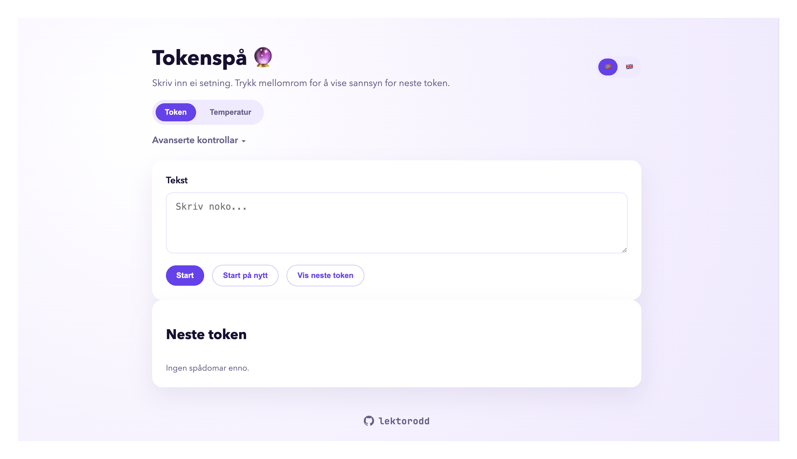

# Tokenspå 🔮



## 1) Kva gjer appen?
Tokenspå viser kva modellen trur kjem **neste**, og korleis **temperatur** og sampling‑val endrar token‑vala.

- **Token‑fana** viser eit sannsyns‑diagram for neste token.
- **Temperatur‑fana** viser fleire parallelle forslag med ulike temperaturar.
- Under **Avanserte kontrollar** finn du:
  - **`top_p`**: avgrensar utvalet til dei mest sannsynlege tokena.
  - **`top_k`**: kor mange av dei mest sannsynlege tokena som blir viste.
  - **Token per steg**: kor mange token som blir henta per steg i temperatur‑fana.

## 2) Kom i gang

### Steg A: Få ein OpenAI API‑nøkkel
1. Logg inn på OpenAI‑kontoen din.
2. Lag ein ny API‑nøkkel.
3. Ta vare på nøkkelen.

### Steg B: Få appen på maskina di
1. Last ned eller klon prosjektet til maskina di.
2. Opne eit terminal‑vindauge i prosjektmappa.

### Steg C: Set opp nøkkelen
1. Lag ei fil som heiter `.env` i prosjektmappa.
2. Legg inn nøkkelen slik:
```
OPENAI_API_KEY=din_nøkkel_her
```
Valfritt: vel modell (standard er `gpt-4.1-mini`). Modellen må støtte `logprobs`:
```
OPENAI_MODEL=gpt-4.1-mini
# Berre for resonneringsmodellar som berre gir logprobs utan resonnering:
# OPENAI_REASONING_EFFORT=none
```
Test kva modellar som fungerer med:
```
npm run check -- gpt-4.1-mini gpt-4o-mini
```
Denne fila er lokal og blir ikkje brukt av appen utan at du lagar ho sjølv. Del aldri API‑nøkkelen offentleg.

> **Merk:** `gpt-3.5-turbo-instruct` og `/v1/completions` vart stengde i september 2026. Appen brukar no Chat Completions med `logprobs`. Chat‑modellar er instruerte til å først gjenta det siste ordet i teksten og så halde fram, slik at token med og utan mellomrom («␠så»/«så») og halve ord blir rette. Fordelinga liknar, men er ikkje heilt lik ein rein «base»-modell: chat‑modellar er ofte svært sikre (t.d. 97 % på eitt token), så temperatur og `top_p` gjer mindre utslag enn før. I token‑fana blir `top_p` ikkje sendt med, sidan API‑et då gøymer alternativ. I temperatur‑fana: set `top_p` til 1 for å sjå tydelegast effekt av temperatur.

### Steg D: Start appen
1. Installer avhengigheiter:
```
npm install
```
2. Start appen:
```
npm run dev
```
3. Opne nettlesaren:
```
http://localhost:3000
```

### Steg E: Bruk appen
- Skriv inn tekst i feltet.
- Trykk **Start** for å låse teksten.
- Bruk **piltastar/space** for å velje og legge til token, eller trykk **Vis neste token** for å legge til det valde (som standard det mest sannsynlege) tokenet.
- I **Temperatur‑fana**: Trykk **Neste token** for å avsløre eitt steg i alle felt.
